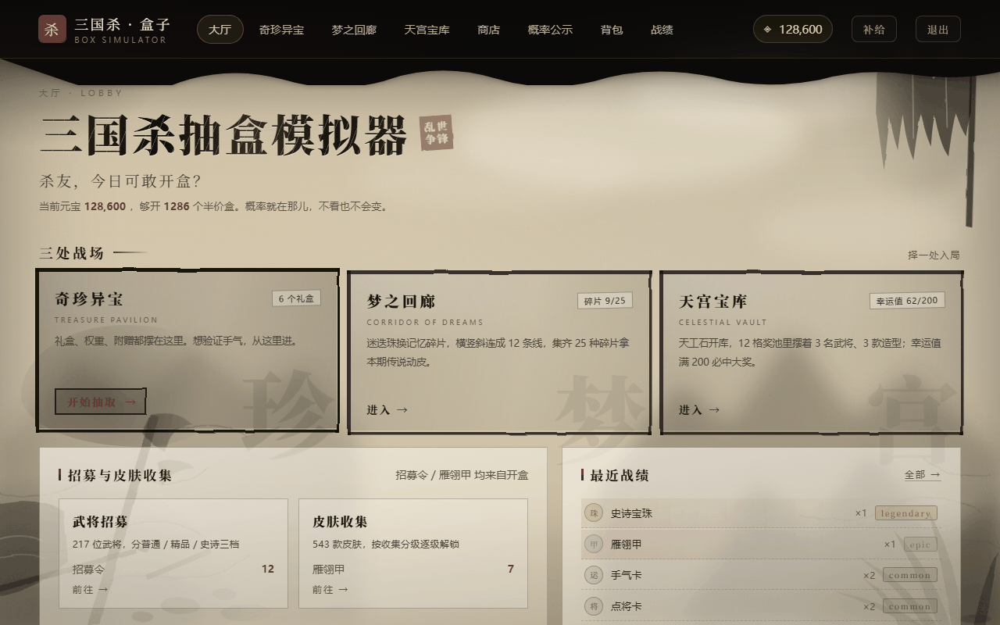
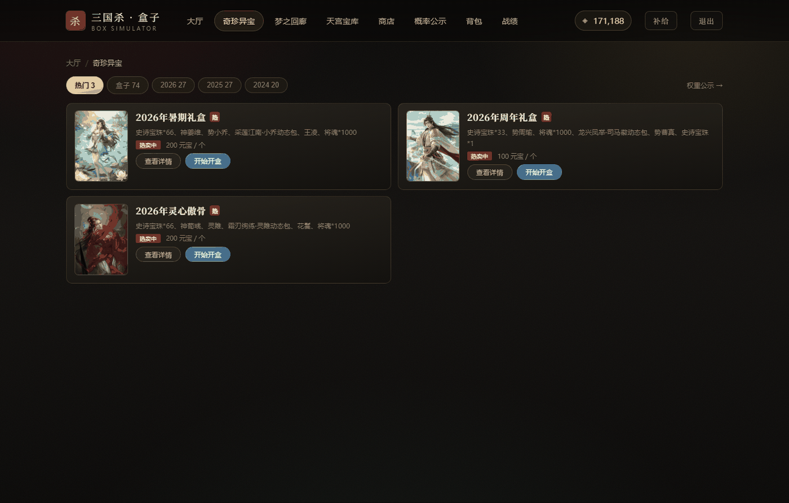
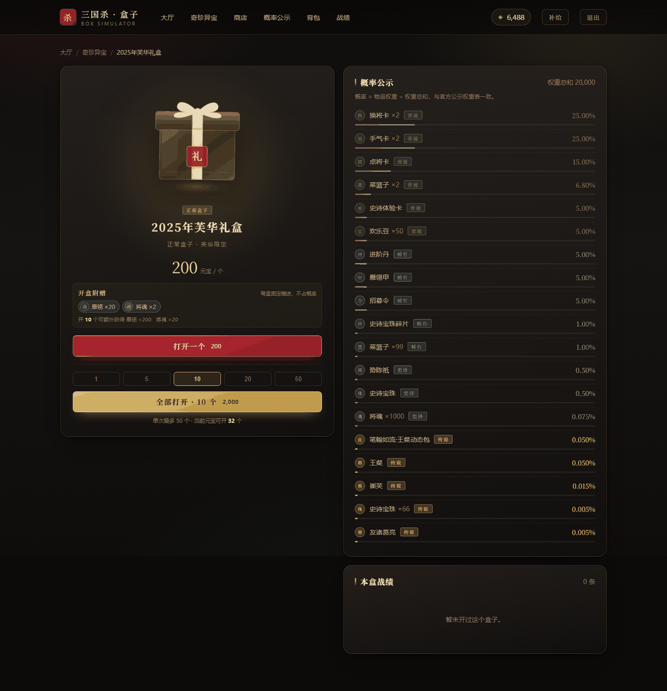
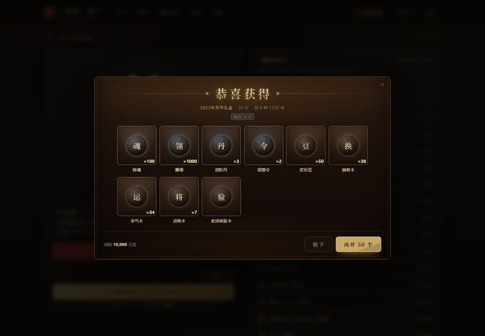
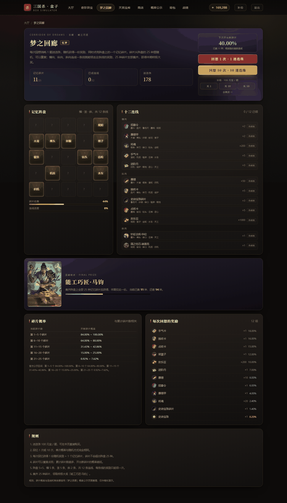
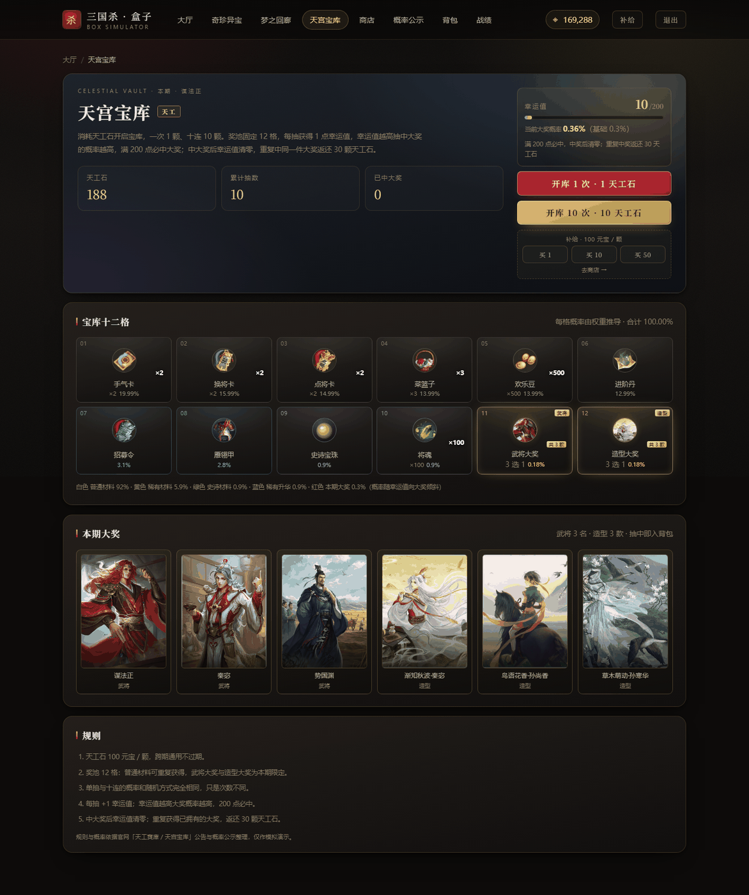
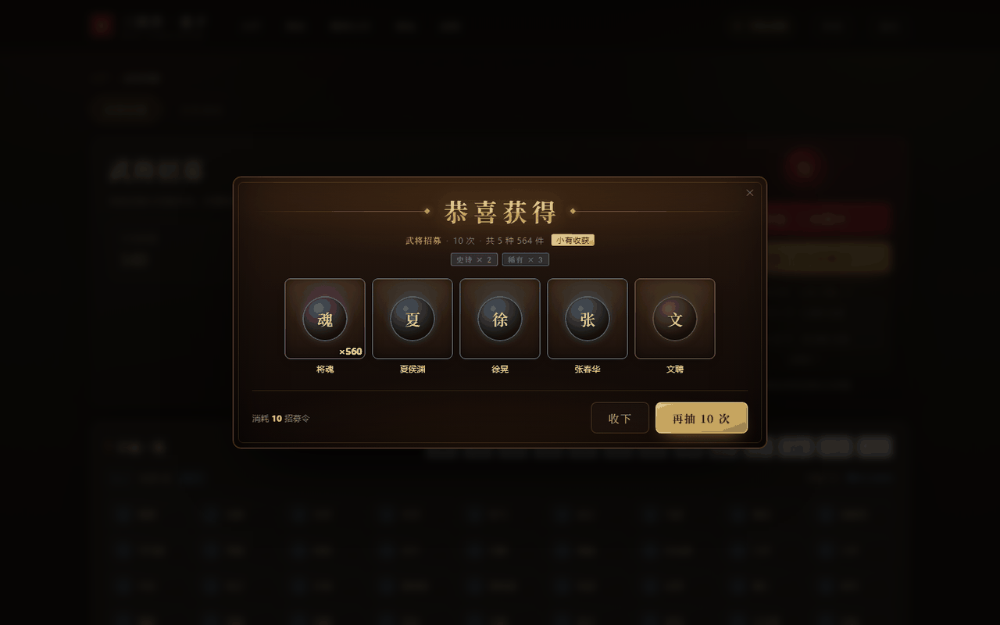
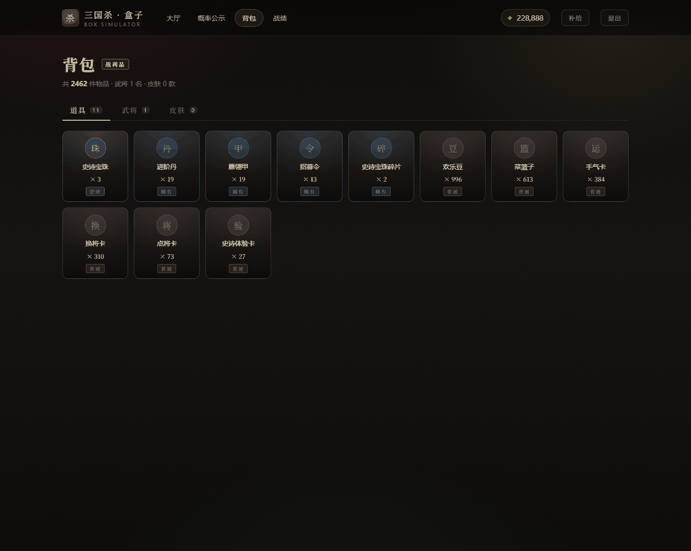

# 三国杀移动版 · 盒子模拟器

> 依据官方公开概率公示数据构建的抽奖系统模拟与概率演示工具。
> **本项目为非官方第三方项目，与游戏运营方无任何关联，不提供任何形式的充值、交易或付费服务。**


---

## 目录

- [项目简介](#一项目简介)
- [功能概览](#二功能概览)
- [界面预览](#三界面预览)
- [技术架构](#四技术架构)
- [快速开始](#五快速开始)
- [目录结构](#六目录结构)
- [数据与卡池](#七数据与卡池)
- [配置与维护](#八配置与维护)
- [质量保障](#九质量保障)
- [API 参考](#十api-参考)
- [实现说明](#十一实现说明)
- [视觉与交互设计](#十二视觉与交互设计)
- [数据来源与合规说明](#十三数据来源与合规说明)
- [免责声明](#十四免责声明)
- [使用许可](#十五使用许可)

---

## 一、项目简介

本项目以《三国杀移动版》官方公开发布的各类概率公示文档为唯一数据来源，完整复现游戏内四类抽奖系统的交互流程与概率模型：

- **奇珍异宝**：礼盒开箱系统；
- **梦之回廊**：碎片拼图与连线奖励系统；
- **天宫宝库**：棋盘式奖池与幸运值保底系统；
- **招募与皮肤收集**：武将招募池与皮肤收集池。

系统的核心原则是**概率完全由权重推导**：所有卡池以相对权重存储，运行时按 `概率 = 单项权重 ÷ 权重总和` 归一化，代码中不存在硬编码概率、动态调权或人为干预结果的情况。任一卡池的实际抽取分布均可通过 `/odds` 页面公开查阅，也可通过内置抽样校验脚本复核。

> 本项目用于概率模型的学习与演示。所有元宝、道具、武将、皮肤均为虚拟数据，不可兑换任何真实物品。

---

## 二、功能概览

| 模块 | 说明 |
| --- | --- |
| 大厅 | 提供三处玩法入口，采用泼墨转场动效 |
| 奇珍异宝 | 共 **74 只礼盒**：在售 3 只 + 往期 71 只（2024–2026 年，含官方已下架的限时礼盒，可按年份筛选）。半价盒 100 元宝、正常盒 200 元宝，支持单次开启与批量开启（单次上限 50 个） |
| 开盒附赠 | 每开启一个礼盒固定赠送：半价盒「雁翎 ×10 + 将魂 ×1」，正常盒「雁翎 ×20 + 将魂 ×2」。附赠不占用概率、不计入抽取流水与总抽数 |
| 结果结算 | 以网格形式展示，同名奖励合并并累加数量；附赠件与掉落件按名称合并；重复抽取的武将、皮肤标注「重复」角标 |
| 招募 | 消耗「招募令」，卡池共 **217 名武将**，按官方《武将招募权重公示》逐将抽取，分为普通 53 / 精品 149 / 史诗 15 |
| 皮肤收集 | 消耗「雁翎甲」，卡池共 **543 款皮肤**，按官方《皮肤收集权重公示》逐款抽取；收集款数达到阈值后逐级解锁分级 1–16 |
| 重复卡处理 | 重复武将、皮肤不自动折算，照常入包并累加数量。可在背包中手动分解：武将兑换将魂（普通 3 / 精品 15 / 史诗 75），皮肤兑换雁翎（普通 100 / 精良 150 / 稀有 400 / 史诗 1500）。最后一份始终保留 |
| 天宫宝库 | 复现官方特惠中心界面：12 格棋盘（5 列 × 3 行）、红蓝绸带大奖架、「抓 1 次 / 抓 10 次」操作。已录入 **15 期**，往期可回看大奖与奖池但不可抽取。每期幸运值独立，满 200 必中大奖；重复大奖返还 30 天工石。天工石不足时按钮不置灰，点击后弹出补给面板，补足后自动继续抽取 |
| 梦之回廊 | 复现官方三栏界面：左侧期数列表（按年份分组）、中央大奖皮肤立绘、右侧 5×5 记忆阵盘 + 外圈 12 格连线奖励。已录入官方公示的 **全部 77 期**（2023-11 卜卦观签 ～ 2026-10 烬策焚粮），每期进度独立保存。迷迭珠 300 元宝 / 颗，集齐 25 种碎片获得本期传说动态皮肤。每期保底抽数不同（250 / 500 / 600 等） |
| 商店 | 招募令 1000 / 雁翎甲 500 / 天工石 100 / 迷迭珠 300 元宝，支持一次购买 1 / 5 / 10 / 50 个 |
| 背包 | 道具、武将、皮肤三类分栏，支持分解与批量开启（如「一堆银币」） |
| 战绩 | 稀有度分布、近 7 日抽取曲线、高光时刻、完整流水 |
| 概率公示 | `/odds` 页面对所有访问者公开全部卡池权重与推导概率 |

### 天宫宝库概率构成

依据官网《天工宝库概率公示》，权重合计 10000：

| 档位 | 概率 | 内容 |
| --- | --- | --- |
| 普通 | 85.00% | 菜篮子 ×2（25.5%）、银币 ×188（19%）、手气卡 ×2（15.5%）、换将卡 ×2（15%）、欢乐豆 ×88（10%） |
| 精品 | 14.70% | 进阶丹 ×1（5%）、雁翎甲 ×1（4%）、招募令 ×1（2%）、将魂 ×88（2.2%）、雁翎 ×888（1.5%） |
| 稀有 | 0.30% | 精品武将（0.15%）、史诗皮肤（0.15%） |

奖池中**不包含点将卡与史诗宝珠**。

### 梦之回廊奖励结构

每次回想消耗迷迭珠，从 11 项道具中随机获得奖励（菜篮子 ×2 9.495% / 欢乐豆 ×50 5% / 点将卡 ×2 15% / 换将卡 ×2 20% / 手气卡 ×2 20% / 进阶丹 ×1 10% / 雁翎甲 ×1 10% / 招募令 ×1 6% / 史诗宝珠碎片 ×1 4% / 史诗宝珠 ×1 0.5% / 史诗宝珠 ×66 0.005%），并点亮阵盘格子。

阵盘外圈共 12 格奖励：右侧一列 5 格对应 5 条横线，底部一行 7 格对应 5 条竖线与左右两端的两条斜线。连线达成后对应格子翻为亮底。每期 12 格内容逐期不同，配置于 `corridor.json` 的 `line_rewards`。

---

## 三、界面预览

<table>
  <tr>
    <td align="center" width="50%"><br><sub><b>大厅 · 三处玩法入口</b></sub></td>
    <td align="center" width="50%"><br><sub><b>奇珍异宝 · 礼盒列表</b></sub></td>
  </tr>
  <tr>
    <td align="center"><br><sub><b>开盒页 · 乌木宝匣</b></sub></td>
    <td align="center"><br><sub><b>开盒结果 · 50 连</b></sub></td>
  </tr>
  <tr>
    <td align="center"><br><sub><b>梦之回廊 · 阵盘与连线</b></sub></td>
    <td align="center"><br><sub><b>天宫宝库 · 12 格奖池</b></sub></td>
  </tr>
  <tr>
    <td align="center"><br><sub><b>武将招募 · 十连</b></sub></td>
    <td align="center"><br><sub><b>背包 · 三类分栏</b></sub></td>
  </tr>
</table>

其余界面（登录、武将招募池、皮肤收集分级、战绩统计、概率公示、移动端适配等）见 [`docs/screenshots/`](docs/screenshots/)。

---

## 四、技术架构

| 层次 | 技术选型 |
| --- | --- |
| 前端 | Vue 3 + Vite + Pinia + Vue Router，无 UI 组件库，样式与组件全部手写 |
| 后端 | FastAPI + SQLAlchemy 2.x + SQLite（WAL 模式） |
| 认证 | PBKDF2-SHA256 口令散列 + JWT |
| 部署 | Docker Compose：Nginx 托管静态资源并反向代理 `/api`；亦提供本地脚本启动器 |

前后端通过统一的 `/api` 前缀通信。前端在开发模式下由 Vite 代理至后端，生产模式下由 Nginx 或本地启动器代理。

### 页面路由

| 路由 | 页面 | 说明 |
| --- | --- | --- |
| `/` | 大厅 | 仅展示三处玩法入口，不直接列出礼盒 |
| `/login` | 登录 | 注册、登录与游客试玩 |
| `/treasure` | 奇珍异宝 | 礼盒列表、年份筛选、开箱入口 |
| `/box/:id` | 开盒页 | 指定礼盒的开箱操作与当前礼盒战绩 |
| `/corridor` | 梦之回廊 | 77 期迷迭珠回想、25 格阵盘、12 条连线；支持 `?period=corr-77` 直达指定期 |
| `/palace` | 天宫宝库 | 12 格奖池与幸运值保底 |
| `/recruit/:pool` | 招募 / 皮肤收集 | `pool` 取 `hero` 或 `skin` |
| `/shop` | 补给商店 | 道具购买 |
| `/inventory` | 背包 | 道具、武将、皮肤三类 |
| `/stats` | 战绩 | 抽取统计与流水 |
| `/odds` | 概率公示 | 免登录公开全部卡池权重 |

---

## 五、快速开始

### 环境要求

- Python 3.10 及以上（后端已按 3.13 验证）
- Node.js 18 及以上（仅构建前端时需要）
- Windows 用户可使用随仓库提供的批处理启动器，无需 Docker

### 方式一：本地脚本启动（Windows，推荐）

首次运行前需构建前端产物：

```bat
cd frontend
npm install
npm run build
```

随后双击项目根目录的 `start.bat`。该脚本将依次完成：

1. 启动后端服务（`127.0.0.1:8000`，端口被占用时自动顺延）；
2. 启动带 `/api` 反向代理的静态服务，托管 `frontend/dist`（`127.0.0.1:8080`，同样支持端口顺延）；
3. 自动打开浏览器。

等价命令为：

```bat
python run.py
```

关闭该命令行窗口即停止全部服务。

> 前端使用相对路径 `/api` 请求接口，因此**必须经由反向代理访问**。直接双击 `dist/index.html` 将导致所有接口请求 404。

### 方式二：Docker Compose

```bash
cp .env.example .env          # 按需修改端口与密钥
docker compose up -d --build
```

启动完成后访问 <http://localhost:8080>，接口文档位于 <http://localhost:8000/api/docs>。

```bash
docker compose logs -f backend   # 查看日志
docker compose down              # 停止服务
docker compose down -v           # 停止并清除数据
```

### 方式三：本地开发

```bash
# 后端
cd backend
python -m venv .venv && source .venv/bin/activate   # Windows: .venv\Scripts\activate
pip install -r requirements.txt
DATA_DIR=./data uvicorn app.main:app --reload --port 8000

# 前端（另开终端）
cd frontend
npm install
npm run dev        # http://localhost:5173，已配置 /api 代理至 8000
```

### 初始账号

首次访问需登录。可在登录页注册新账号，或使用「一键游客试玩」，初始元宝 8888。元宝可通过页面上的「补给」按钮模拟充值。

### 环境自检与故障排查

执行 `检查环境.bat`（等价于 `python run.py --check`）将逐项检查解释器、依赖、前端产物、素材数量、端口占用与后端健康状态，异常项以 `[X]` 标注。

| 现象 | 原因 | 处理方式 |
| --- | --- | --- |
| 启动窗口一闪而过 | 缺少 Python 环境或 `frontend/dist` 不完整 | 窗口会保留并输出提示信息 |
| 提示 8000 端口被占用 | 上次进程未正常退出 | 启动器自动改用 8001，日志中会注明 |
| 页面可打开但接口报错 | 本地请求被系统代理（如 Clash、加速器）劫持 | 启动器对 `127.0.0.1` 强制绕过代理 |
| 页面白屏 | 浏览器缓存了旧版 `index.html`，其引用的脚本指纹已失效 | HTML 响应设置 `no-store`，刷新即可 |
| 页面全黑，仅有背景色 | 旧 HTML 命中缓存而主脚本 404 | 页面内置兜底逻辑：脚本加载失败时自动带时间戳重载一次；仍失败则显示原因，可 `Ctrl+Shift+R` 强制刷新 |
| 页面底部显示红色说明 | 脚本未能执行（缓存过期、扩展拦截、内核过旧） | 按提示操作；启动器每次使用带时间戳的地址打开页面 |

---

## 六、目录结构

```
Sanguosha-Mobile Box Simulator/
├── start.bat                    # Windows 启动脚本
├── run.py                       # 启动器：后端 + 静态服务 + /api 反向代理
├── 检查环境.bat                 # 环境自检
├── docker-compose.yml
├── .env.example
├── data/                        # 运行时生成的 SQLite 数据库（挂载至容器）
├── docs/screenshots/            # 界面截图
├── image/                       # 武将、皮肤、道具素材
├── backend/
│   ├── Dockerfile
│   ├── requirements.txt
│   └── app/
│       ├── main.py              # FastAPI 入口、公开概率接口、请求串行化中间件
│       ├── config.py            # 环境变量配置
│       ├── models.py            # 数据表结构（User / InventoryItem / PullRecord）
│       ├── security.py          # PBKDF2 口令散列与 JWT 签发
│       ├── gacha.py             # 权重加载、归一化、加权抽样
│       ├── services.py          # 背包入库与消耗
│       ├── lock.py              # 写请求串行化锁
│       ├── data/                # 全部卡池数据（见第七节）
│       └── routers/
│           ├── auth.py          # 注册、登录、元宝补给
│           ├── boxes.py         # 礼盒开箱
│           ├── recruit.py       # 武将招募、皮肤收集
│           ├── shop.py          # 商店
│           ├── palace.py        # 天宫宝库
│           ├── corridor.py      # 梦之回廊
│           └── collection.py    # 背包、流水、统计
├── frontend/
│   ├── Dockerfile
│   ├── nginx.conf
│   └── src/
│       ├── views/               # 大厅、奇珍异宝、梦之回廊、天宫宝库、开盒、招募、商店、背包、战绩、公示
│       ├── components/          # 礼盒插画、结果弹层、概率条、道具图标
│       ├── composables/         # 泼墨转场等交互逻辑
│       ├── stores/auth.js
│       └── styles/main.css      # 全站视觉变量与纹理
└── tools/                       # 数据构建、校验与截图工具
```

---

## 七、数据与卡池

全部卡池数据以 JSON 形式存放于 `backend/app/data/`，无需修改代码即可调整。

| 文件 | 内容 | 规模 |
| --- | --- | --- |
| `boxes.json` | 礼盒完整权重表（在售 3 + 往期 71，含已下架限时礼盒） | 74 只 |
| `heroes.json` | 武将招募池，逐将权重与品级 | 217 名 |
| `skins.json` | 皮肤收集池，逐款权重与分级 | 543 款 |
| `palace.json` | 天宫宝库 12 格奖池与逐期大奖 | 15 期 |
| `corridor.json` | 梦之回廊碎片、连线、奖池与逐期保底 | 77 期 |
| `shop.json` | 商店商品与价格 | 4 项 |

### 礼盒数据构成

礼盒数据分为两批：

1. **在售礼盒 3 只**（暑期 / 周年 / 灵心），依据开发指南公示权重表录入；
2. **往期复刻礼盒 71 只**（2024-01 腊八 ～ 2026-10 千幻万劫，含官方已下架的限时礼盒），依据官网《道具概率公示集中帖》的概率图逐期对齐，由 `tools/build_past_boxes.py` 与 `tools/build_all_boxes.py` 生成，每只礼盒的权重总和与概率和在构建时均有断言校验。

代表性样例（完整清单见 `boxes.json`）：

| 礼盒 | 类型 / 价格 | 权重总和 | 项数 | 顶级奖励 |
| --- | --- | --- | --- | --- |
| 2026 年周年礼盒 | 半价 / 100 | 10000 | 17 | 势周瑜、史诗宝珠 ×33（0.01%） |
| 2025 年芙华礼盒 | 正常 / 200 | 20000 | 18 | 友诸葛亮（0.005%）、崔芙（0.015%）、王粲（0.05%） |
| 2026 年暑期礼盒 | 正常 / 200 | 20000 | 19 | 神姜维（0.005%）、势小乔（0.015%）、王凌（0.05%） |
| 2025 年感恩礼盒 | 正常 / 200 | 20000 | 18 | 友诸葛亮（0.005%）、蒋济（0.015%）、董允（0.05%） |
| 2024 年腊八礼盒 | 正常 / 200 | 20000 | 19 | 界沮授（0.005%）、神华佗（0.015%）、花鬘（0.05%） |

**权重模板说明**

官方公示的礼盒共四类权重模板：

| 模板 | 售价 | 总权重 | 换将卡 ×2 | 手气卡 ×2 | 点将卡 | 菜篮子 ×2 | 稀有区尾 |
| --- | --- | --- | --- | --- | --- | --- | --- |
| 正常盒（含点将卡） | 200 | 20000 | 5000 | 5000 | ×2 / 3000 | 配平项 | 宝珠 ×66 / 权 1 武将 |
| 正常盒（不含点将卡） | 200 | 20000 | 6500 | 6500 | — | 配平项 | 同上 |
| 半价盒（含点将卡） | 100 | 10000 | 3000 | 3000 | ×1 / 1000 | 配平项 | 宝珠 ×33 |
| 半价盒（不含点将卡） | 100 | 10000 | 3500 | 3500 | — | 配平项 | 同上 |

- **菜篮子 ×2 为官方配平项**，其权重等于总权重减去其余各项之和，因此逐期数值略有差异（1088 / 1255 / 1344 / 1360 等），非录入误差。
- 74 只礼盒中，**8 只**为半价盒（`anniversary_2026`、`jianxin_2026`、`qianlong_2026`、`xianfeng_2025`、`qingguo_2025`、`anniversary_2024`、`shengshi_2024`、`guose_2024`），其余 66 只为 200 元宝。
- 稀有区尾部顺序固定：精品武将（good）→ 史诗宝珠 ×1 → 将魂 ×1000 → 皮肤动态包 → 权 3 武将 → 史诗宝珠 ×66（半价盒 ×33）→ 权 1 武将。
- `龙腾四海` 为福袋结构而非礼盒：整池 10 行、总权重 10000，手气卡与换将卡均为 ×1，已单独建模。
- 各期精品武将不同（谋于禁、严畯、甘夫人、濮阳兴、马日磾、阮慧、胡班、贾诩等），均按公示图逐期录入。

### 招募池与皮肤池

两个卡池均为官方公示数据，非占位内容：

| 卡池 | 数据来源 | 规模 |
| --- | --- | --- |
| 武将招募 | [武将招募权重公示](https://www.sanguosha.cn/news/detail/7.html)（2025-03-11 更新） | 217 名，逐将权重 153 / 100 / … / 4 |
| 皮肤收集 | [皮肤收集权重公示](https://www.sanguosha.cn/news/detail/9.html)（2026-05-15 更新） | 543 款，逐款权重 125 / 150 / 166 / … / 8 |

原始转录文件保留于 `image/官网素材/`：`hero_recruit_official.json`（武将名称、分级 1–20、招募权重）与 `skin_collect_official.txt`（皮肤名称、所属武将、分级 1–16、收集权重）。

**品级推导方式**：官方公示页仅提供「武将分级 + 权重」，未直接标注品级。构建脚本依据官方三档概率反推：

| 品级 | 武将分级 | 人数 | 推导合计概率 | 官方公示 |
| --- | --- | --- | --- | --- |
| 普通 | 1–5 | 53 | 16.55% | 16.54% |
| 精品 | 6–14 | 149 | 83.17% | 83.17% |
| 史诗 | 16–20 | 15 | 0.28% | 0.28% |

三项结果与社区公示数据完全吻合，可确认分级归属正确。

皮肤品级（普通 / 精良 / 稀有 / 史诗）取自社区 wiki 皮肤表的「品质」字段，并与官方分级交叉校验（分级 8–9 对应稀有，15–16 对应史诗，1–7 混合普通与精良）；wiki 未收录的个别皮肤按分级回退。

**收集分级**：官方规则为收集款数达到阈值后解锁更高分级，卡池随收集进度扩大。`skins.json` 的 `grade_thresholds` 即官方阈值表（0 / 4 / 6 / 14 / 25 / 37 / 60 / 70 / 84 / 98 / 117 款），后端按用户实际收集款数过滤卡池并重新归一化概率；卡池全部收集完毕后提示「本期已全部收集」。

### 天宫宝库

- `grid` 定义页面上的 12 个格子，`weight` 为相对权重，`tier` 控制描边配色（white / yellow / green / blue / red），`group` 为官方公示的三档分类。
- **棋盘布局固定于前端**（`PalaceView.vue` 的 `SEATS`），按官方界面排布为 5 列 × 3 行：第 1 行「雁翎 / 菜篮子 / 银币 / 手气卡 / 皮肤（金格）」，第 2 行「换将卡 / 幸运值面板（跨 3 列）/ 欢乐豆」，第 3 行「将魂 / 进阶丹 / 雁翎甲 / 招募令 / 武将（金格）」。普通格按 `grid` 中道具的 `key` 落座，`key` 不匹配时按原顺序补位，保证不丢格。
- 布局采用纯 CSS Grid 自适应：格子 `aspect-ratio: 4/5`、`container-type: inline-size`，图标宽度 72%，字号基于 `cqi` 并设 `max(9px, …)` 下限，任意视口均无需缩放脚本。
- 大奖格以 `"grand": "hero" | "skin"` 标记，`grand_prizes` 列出候选名单；抽中时在名单内随机，已拥有则按 `repeat_refund` 返还天工石。入包 `key` 会做去「·」归一（`hero:谋法正` 与 `hero:谋·法正` 视为同一项），避免官方公告的两种写法导致跨期重复奖励不触发返还。
- `pity_limit`（默认 200）为幸运值上限；`gacha.py` 的 `PALACE_LUCK_BOOST` 控制幸运值对大奖权重的放大系数，满值时放大 5 倍（0.30% → 1.48%）。

### 梦之回廊

- `fragments` 固定 25 项（`id` 0–24）；`lines` 的 `cells` 记录碎片 id，按行优先、0 起始排列（0–4 为第一行，5–9 为第二行，依此类推）。
- `draw_pool` 为每次回想的奖励池，依据官网公示的「碎片奖励」表录入（11 项，合计 100%）。
- **碎片概率与保底逐期不同**：`periods[].fragment_rates`（25 个值）与 `periods[].pity_limit` 覆盖顶层同名字段。官方公示图共 7 种表：末档 1.03%（保底 250 抽，42 期）、1.15%（250 抽，16 期）、0.29%（600 抽，9 期）、0.41%（500 抽，1 期）、1.84%（180 抽，3 期）、4.00%（120 抽，3 期）、三倍概率 8.00%（150 抽，3 期）。
- `pity_limit` 为**硬保底**：累计回想达到该次数时，后端强制补齐剩余碎片并发放终极大奖，返回 `note` 标注「保底达成」。官方公示仅提供概率、未设保底，该机制为便于演示而增加的兜底，界面标注为「模拟保底」。若在保底前提前集齐，剩余次数不再消耗迷迭珠，差额自动退回。
- 「一堆银币」为未开启道具（`item:silver_pile`）：连线奖励发放包裹本体，进入背包后由玩家主动开启（`POST /api/inventory/open`）并获得 1000–10000 银币，发放时不折算为数量。
- 连线奖励逐期配置于 `periods[].line_rewards`，共 12 个键：`row-1~5`（右侧竖列）、`col-1~5`（底部横排）、`diag-1`（左下角，对应「右上→左下」副对角，格 4/8/12/16/20）、`diag-2`（右下角，对应主对角，格 0/6/12/18/24）。顶层 `lines[].reward` 仅作兜底模板。
- 连线中的皮肤格跟随该期 `diag_reward` 动态覆盖，无需重建 `line_rewards`。
- 期数数据由 `tools/build_corridor.py` 依据 `tools/corridor_official.json`（官网 77 期公示清单）生成。重建后，旧 `corr-01~22` 的进度可用 `tools/migrate_corridor_state.py` 按（皮肤, 武将）迁移至新 id。
- 皮肤图**仅使用真实皮肤原画**。77 期已全部配齐；后续新增期若暂缺素材，阵盘以暗金格占位、立绘角标注明「皮肤原画暂未收录」，不以武将立绘替代。

### 素材资源

抽奖结果按名称加载对应图片，素材位于项目根目录 `image/`，由后端挂载为静态目录：

| 目录 | 内容 | 命名规则 | 是否随仓库分发 |
| --- | --- | --- | --- |
| `image/武将图片/` | 602 张武将原画 | `<武将>.jpg`，保留前缀（`界严颜` ≠ `严颜`） | 否，需自行抓取 |
| `image/皮肤图片/` | 1333 张皮肤原画 | `<武将>_<皮肤名>.jpg` | 否，需自行抓取 |
| `image/道具图片/` | 19 张道具图标 | `<道具名>.png` | 是，仓库内置 |

- 后端将 `image/` 挂载至 `/api/media`（可用 `IMAGE_DIR` 覆盖），前端统一通过 `mediaUrl()` 取图，中文路径逐段编码。
- 修改素材或卡池后须执行 `tools/build_media_map.py` 重新生成 `frontend/src/assets/media-map.json`，否则新增名称无法匹配图片。
- 图片缺失时 `ItemGlyph` 自动回退为字形占位，不会出现破图。

#### 素材获取说明

武将原画与皮肤原画合计约 1.3 GB，超出常规仓库容量，故未随代码分发。首次部署须联网抓取一次，全部来源为官网与哔哩哔哩 wiki 的公开页面，无需登录：

```bash
# 1. 官网武将原画（第 1 张为武将原画，其余为该武将的官方皮肤图）
python tools/fetch_sgs_assets.py heroes --all

# 2. wiki 皮肤原画：按「武将_皮肤名.jpg」直接写入 image/皮肤图片/（皮肤原画的主要来源）
python tools/fetch_wiki_skins.py

# 3. 绘影堂高清皮肤原画（1920×1305，用于覆盖 wiki 版）
python tools/fetch_sgs_assets.py skins

# 4. 整理为项目目录结构：武将原画归位、皮肤统一命名
python tools/prepare_assets.py

# 5. 重建素材索引并重新打包前端
python tools/build_media_map.py
cd frontend && npm run build
```

- 第 1、3 步的产物是原始图集（`image/官网素材/`），须由第 4 步整理后才会被程序使用；`prepare_assets.py` 加 `--dry-run` 可先统计而不写文件。
- 全部脚本支持断点续跑：已存在的文件自动跳过，中断后重新执行即可。
- 抓取完成后可执行 `python tools/build_index.py` 生成 `image/index.html` 素材总览页与 `image/素材清单.csv` 清单，便于核对缺图。
- 仅完成第 1、4 步时，皮肤数量约 129 张，多为经典形象；第 2 步才是皮肤原画的完整来源。若暂不抓取素材，程序仍可正常启动并完成全部抽取逻辑，界面以字形占位替代图片。
- 道具图标（含自绘的「天工石」「迷迭珠」）已内置，无需抓取；如需重新生成自绘图标，执行 `python tools/make_activity_icons.py`。
- 礼盒内出现的武将、皮肤均已配备官方素材（含 2026 年新增皮肤「碧海生潮·司马徽」「蛇年中秋·甘夫人」及武将「刘巴」「吴班」）。仅 9 种礼盒限定道具（各期武将碎片 7 种、`桃园结义皮肤包`、`古城相会皮肤包`）无官方图标，采用字形回退。
- 补图与命名冲突处理的细节见 [`tools/README.md`](tools/README.md)。

---

## 八、配置与维护

所有数值均存放于 `backend/app/data/*.json`，修改后重启后端即生效。

### 新增礼盒

在 `boxes.json` 的 `boxes` 数组中追加一项：

```json
{
  "id": "my_box",
  "name": "自定义礼盒",
  "subtitle": "示例",
  "category": "half",
  "category_name": "半价盒子",
  "price": 100,
  "total_weight": 1000,
  "theme": "crimson",
  "description": "示例礼盒",
  "pool": [
    { "key": "basket", "name": "菜篮子", "qty": 2, "weight": 990, "kind": "item", "rarity": "common" },
    { "key": "hero_x", "name": "某武将", "qty": 1, "weight": 10, "kind": "hero", "rarity": "epic" }
  ]
}
```

字段约定：

- `weight` 为相对权重，无需等于百分比，程序自动归一化；`total_weight` 必须严格等于池内权重之和，否则校验脚本将报告不一致。
- `key` 相同的物品会合并堆叠（74 只礼盒中的菜篮子共用 `basket`）。
- 池内条目 `pool[].kind` 取 `item` / `hero` / `skin`，决定背包归类与图标。
- `rarity` 取 `common` / `good` / `fine` / `rare` / `epic` / `legendary`，决定配色与动效。武将无传说档，官方仅设普通 / 精品 / 史诗三级；皮肤最高可至传说。
- `theme` 取 `crimson` / `gold` / `azure` / `amber` / `plum`，仅影响礼盒插画与页面底色。
- 礼盒对象自身的 `kind` 用于区分上架状态：`"past"` 为往期，`"current"` 为在售。

### 调整开盒附赠

`boxes.json` 中每只礼盒均有一段 `bonus`，按「每开启一个礼盒的赠送量」配置：

```json
"bonus": [
  { "key": "feather",   "name": "雁翎", "kind": "item", "rarity": "rare", "qty": 20 },
  { "key": "soul_1000", "name": "将魂", "kind": "item", "rarity": "epic", "qty": 2 }
]
```

- `qty` 为单个礼盒的赠送量，开启 10 个自动发放 10 份。
- 附赠不参与权重抽取，不计入总抽数与抽取流水。
- `key` 与卡池同名道具共用，会自动叠为同一格。
- 删除 `bonus` 字段即该礼盒不再附赠。
- **开盒附赠为本模拟器增设、官方公示表中不存在的项目**，仅影响体验、不影响概率；删除该字段即为纯官方口径。

### 调整商店

编辑 `shop.json`：

```json
{
  "items": [
    { "key": "token_1", "name": "招募令", "price": 1000, "kind": "item", "rarity": "rare" },
    { "key": "armor_1", "name": "雁翎甲", "price": 500,  "kind": "item", "rarity": "rare" }
  ]
}
```

`key` 必须与礼盒中同名道具的 `key` 一致，否则购买所得与开箱所得会分裂为两格。追加新商品无需修改前后端代码。

### 重建招募池与皮肤池

修改 `image/官网素材/` 下的源文件后执行：

```bash
python tools/build_recruit_pools.py            # 重建 heroes.json / skins.json
python tools/build_recruit_pools.py --report   # 仅输出分档统计与缺图清单
python tools/build_media_map.py                # 重建前端查图映射
```

### 变更后的标准流程

```bash
python tools/build_media_map.py     # 素材或卡池有变动时
python tools/e2e_check.py           # 接口与业务不变量自检
cd frontend && npm run build        # 重新构建前端产物
```

---

## 九、质量保障

### 自检工具

| 脚本 | 用途 |
| --- | --- |
| `python tools/e2e_check.py http://127.0.0.1:8000/api` | 后端全接口自检：注册登录、74 只礼盒逐只开箱、招募、商店、天宫宝库 15 期、梦之回廊 77 期逐期回想与保底、背包分解、战绩统计，并校验概率和、保底抽数、余额扣减等业务不变量 |
| `python tools/build_recruit_pools.py --report` | 招募池与皮肤池的分档统计、缺图检查 |
| `node tools/shot.mjs <token> <outDir> <路径…>` | 页面截图，支持 `MOBILE=1`（窄屏）、`VIEWPORT_ONLY=1`（仅首屏）、`"路径\|选择器"`（点击后截图） |
| `node tools/probe.mjs <token> <路径>` | 布局探针：列出超出视口宽度的元素，用于排查移动端横向溢出 |
| `node tools/el_shot.mjs <token> <路径> <out.png> [选择器]` | 按元素外框裁剪截图（默认 `.board-stage`），用于截取首屏之外的区块 |

### 校验口径

- 每只礼盒的权重总和与概率和在构建阶段断言，概率总和须为 100.0000%。
- 抽样校验：礼盒与天宫宝库各执行 20 万次蒙特卡洛抽样，与理论分布比对。
- 天宫宝库另执行 4000 轮保底模拟，验证幸运值机制收敛。
- 一致性校验：元宝扣减、流水记录、背包数量、抽数统计四方对账。

---

## 十、API 参考

| 方法 | 路径 | 说明 |
| --- | --- | --- |
| POST | `/api/auth/register` | 注册，返回 JWT |
| POST | `/api/auth/login` | 登录 |
| GET | `/api/me` | 当前用户与元宝余额 |
| POST | `/api/me/recharge` | 模拟充值 |
| GET | `/api/boxes` | 礼盒列表及各项概率 |
| POST | `/api/boxes/{id}/open` | 开盒，`{"count": 1..50}`，返回 `items`（合并后奖励）与 `bonus`（本次附赠） |
| GET | `/api/recruit/{hero\|skin}` | 招募 / 皮肤收集池与概率 |
| POST | `/api/recruit/{pool}/pull` | 抽取 `{"count": 1..10}` |
| GET | `/api/shop` | 商店货架（名称、单价、已持有数量） |
| POST | `/api/shop/buy` | 购买 `{"item_key": "token_1", "count": 1..99}` |
| GET | `/api/inventory` | 背包 |
| POST | `/api/inventory/open` | 开启未开启道具（如「一堆银币」） |
| POST | `/api/inventory/decompose` | 分解重复武将 / 皮肤，`{"key": "hero:典韦", "count": 1}`；至少保留一份 |
| GET | `/api/records?limit=30` | 抽取流水，支持 `source` 与 `box_id` 过滤 |
| GET | `/api/stats` | 统计数据 |
| GET | `/api/odds` | 公开概率公示（免登录） |
| GET | `/api/health` | 健康检查 |

鉴权方式：请求头 `Authorization: Bearer <token>`。令牌失效时前端自动清除本地凭证并跳转登录页。

---

## 十一、实现说明

**概率模型**
`gacha.weighted_pick()` 采用累积权重抽样，单抽与批量抽取复用同一函数，不存在与公示值不一致的路径。

**事务与一致性**
元宝扣减、道具入库、流水记录在同一次 commit 内完成，任一环节异常则整体回滚。批量开箱在同一事务内多次命中同一物品时显式 `flush()`，避免唯一键冲突。

**并发控制**
SQLite 采用 WAL 模式、`synchronous=NORMAL` 与 `busy_timeout`。由于 SQLite 为单写者模型，并发「读取余额 → 扣费 → 写回」会产生丢失更新，因此后端通过 HTTP 中间件将全部写请求串行化（`/api/media` 静态资源除外）。经 10 并发单抽压测，元宝扣减、流水与抽数统计完全一致，接口响应时间未出现可感知增长。

**附赠与掉落分离**
`items[].qty` 为合计数量（抽中 + 附赠），`drop_qty` 与 `bonus_qty` 分别可查；附赠件 `pulls` 记为 0，因此不写入流水、不影响总抽数与稀有度分布。

**重复卡策略**
招募与皮肤收集抽到已拥有的卡时仅累加 `inventory.qty` 并标记 `duplicate`，不产生将魂或雁翎。折算仅发生在 `/api/inventory/decompose`，且拒绝分解最后一份。

**消耗与退还**
回廊在保底前提前集齐时立即停止消耗，差额迷迭珠原额退回，并在响应中返回 `refunded` 字段供前端提示。

**参数校验**
不存在的期数返回 404 而非 500；损坏或缺失的权重数据在加载阶段回退为安全值，避免接口整体不可用。

**安全**
口令使用 PBKDF2-SHA256 加随机盐（260,000 次迭代）存储，不保存明文。JWT 签名密钥由 `SECRET_KEY` 配置，生产部署须替换为随机长字符串。

**元宝**
仅为虚拟数值，`/api/me/recharge` 直接发放，项目内不存在任何支付链路。

---

## 十二、视觉与交互设计

全站采用「焦墨 · 朱砂 · 赭石」配色体系，视觉变量集中定义于 `frontend/src/styles/main.css`，页面仅作局部调整。

| 类别 | 取值 |
| --- | --- |
| 焦墨底 | `#1A1714`（`--ink-900`）、卡片 `#2D2720`（`--ink-700`） |
| 朱砂 | `#9E2B25`（`--crimson`）、`#B8463B`（`--crimson-2`） |
| 赭石金 | `#A67C4E`（`--gold`）、`#C9A46E`（`--gold-2`） |
| 旧宣纸 | `#ECE2C8`、`#D6C6A1`，文字 `#4A3F30` |

- **字体**：标题使用行楷字体栈（不引入未授权字体文件）；模块标题使用自托管得意黑 `SmileySans-Oblique.woff2`；正文与数字使用自托管思源黑体。字体文件位于 `frontend/public/fonts/`。
- **纹理**：以 SVG `feTurbulence` 生成宣纸纤维、枯笔飞白与残旗等纹理，避免额外图片请求。
- **稀有度**：统一收敛至墨、朱、赭三色系，以篆刻印戳标识品质，不使用彩色圆点。
- **动效**：按钮悬停采用干笔横扫过渡；全站移除 `backdrop-filter`。三处玩法入口使用泼墨转场——墨团自点击位置扩散覆盖全屏、切换页面、随后收墨。转场状态由 `composables/useInkBurst.js` 管理，遮罩渲染于 `App.vue`（路由之外），保证切换过程中不被卸载。
- **页面氛围层**：各页面以固定定位的装饰层（`z-index: -1`）绘制残旗、远山、干墨笔触与飞墨颗粒，密度控制在 3%–10%，不干扰内容可读性。所有装饰在 `prefers-reduced-motion` 下静止。
- **响应式**：两侧装饰仅在视口宽度大于 1280px 时显示；窄屏下逐步收敛，避免挤压主体内容。

细节实现说明见 `frontend/src/styles/main.css` 与各页面组件内的注释。

---

## 十三、数据来源与合规说明

| 数据 | 来源 |
| --- | --- |
| 礼盒概率 | 官网《道具概率公示集中帖》：<https://www.sanguosha.cn/pc/news-detail-602.html>（2026-09-30 版） |
| 天宫宝库概率 | 官网《天工宝库概率公示》：<https://www.sanguosha.cn/news/detail2/2128.html> |
| 梦之回廊概率 | 官网同页面逐期连线奖励与碎片概率表（7 种） |
| 武将招募概率 | 官网《武将招募权重公示》：<https://www.sanguosha.cn/news/detail/7.html> |
| 皮肤收集概率 | 官网《皮肤收集权重公示》：<https://www.sanguosha.cn/news/detail/9.html> |

本项目为纯净的离线演示工具：不连接官方服务器、不抓取用户数据、不涉及任何支付流程。所有概率数据均来自上述公开页面，可与公示原文逐项核对。

项目内使用的武将立绘、皮肤原画、道具图标等美术资源，著作权归原权利人所有，仅用于技术演示与非商业展示。如需用于其他用途，请自行取得授权。

---

## 十四、免责声明

1. 本项目为个人学习与技术演示项目，**与腾讯公司、《三国杀》运营方及任何官方主体均无关联**，不代表官方立场。
2. 项目不提供真实充值、账号交易、代练或任何付费服务，不存在支付链路。
3. 所有元宝、道具、武将、皮肤及概率结果均为虚拟数据，不可兑换真实物品或服务。
4. 项目中的概率数据来源于官方公开页面，但**不保证与线上版本实时一致**；游戏内容更新后，本项目数据可能存在滞后。
5. 「开盒附赠」与「模拟保底」为本模拟器增设机制，官方面向玩家的公示中并不存在，界面已作标注。
6. 请勿将本项目用于商业用途、二次售卖、引流或任何形式的营利活动。
7. 如有侵权，请联系删除相关资源；本项目对使用本软件产生的一切后果不承担责任。

---

## 十五、使用许可

本项目代码仅供学习、研究与技术交流使用，**未授予商业使用许可**。在保留出处的前提下，可用于非商业性的学习、教学与二次开发。

项目内引用的游戏美术资源、名称与商标归原权利人所有，不在本项目授权范围内。

---

## 致谢

感谢游戏运营方持续公开概率数据，使此类模拟与校验成为可能。
感谢所有为本项目提供游戏内实测截图与数据核对的使用者。
